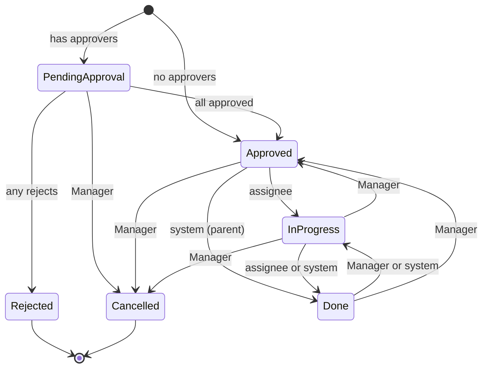

# Requirements: Task Management Application

Business rules are in [business-rules.md](business-rules.md). Rule IDs (BR1, BR2, ...) are referenced here.

## 1. Goal

- A full stack web app for one company with fewer than 1000 users.
- Teams organize work in Projects. Projects have Tasks and Sub-tasks.
- Tasks can need ordered, sequential approvals.
- Users get in-app notifications.
- English only. Works on desktop and mobile browsers.

## 2. Roles

Four roles. One role per user. Admin creates all accounts.

| Role | Summary |
|---|---|
| Admin | Manages users, Departments, and Manager assignment. Sees everything, read only. Cannot comment. |
| Manager | Manages one or many Departments. Runs the Projects of those Departments. Approves, reassigns, cancels, moves tasks backward, archives. |
| Senior | Belongs to one Department. Creates Projects for it. Creates and assigns tasks in his Projects. Can approve when he is a Project member. |
| Junior | Belongs to one Department. Creates tasks only for himself. Each task needs at least one approver. Never approves. |

### 2.1 Departments

- A Senior or Junior belongs to exactly one Department.
- A Manager or Admin belongs to no Department.
- Each Department has at most one Manager. A Manager can manage many Departments.
- The "direct Manager" of a Senior or Junior is the Manager of his Department.
- Each Project belongs to one Department and has many members.

### 2.2 Visibility

| Role | Sees |
|---|---|
| Admin | All Projects and tasks. Read only. |
| Manager | Projects of the Departments he manages, with all their tasks. |
| Senior | Only Projects he is a member of, with all their tasks. |
| Junior | Only Projects he is a member of, with all their tasks. |
| Any approver | Also the task he is an approver on (BR40). |

### 2.3 Permissions matrix

"Own Dept" = the Departments a Manager manages, or the Department of a Senior or Junior.
"Member" = the user is a member of the Project.

| Action | Admin | Manager | Senior | Junior |
|---|---|---|---|---|
| Create users | Yes | No | No | No |
| Edit a user (name, email, role, Department) | Yes, see OQ10 | No | No | No |
| Reset a user's password to a temporary one | Yes | No | No | No |
| Change own password | Yes | Yes | Yes | Yes |
| Create Departments, assign Managers | Yes | No | No | No |
| Rename a Department, change or remove its Manager | Yes | No | No | No |
| View Projects and tasks | All, read only | Own Dept Projects | Member Projects | Member Projects |
| Create Project | No | Yes, in one of his Depts | Yes, in his Dept | No |
| Add member | No | Users of his Depts | Users of his Dept, in Member Projects of his Dept | No |
| Remove member (no assigned tasks) | No | Yes | Same scope as add | No |
| Archive Project | No | Yes, own Dept | No | No |
| Create task | No | Yes, assign to any member | Yes, Member Projects, assign to any member | Only for himself |
| Create sub-task | No | Yes | Yes, Member Projects | Only on his own task, for himself |
| Choose approvers on create | No | Optional | Optional (required for Senior to Senior) | Required, at least one |
| Approve or reject | No | Yes | Yes, if Member | Never |
| Approve and add approvers | No | Yes, as direct Manager on a Senior's task | No | No |
| Reassign | No | Yes | Yes, Member Projects | No |
| Move status forward | No | If assignee | If assignee | If assignee |
| Move status backward | No | Yes | No | No |
| Cancel task | No | Yes, own Dept | No | No |
| Edit Priority and Due date (after approval) | No | Yes | No | No |
| Comment on a task | No | Yes | Yes | Yes |
| Edit or delete a comment | No | Own only | Own only | Own only |

## 3. Entities and fields

General rules:
- Keys are `int` identity.
- Date-times are `datetime2` in UTC.
- `DueDate` is `date`.
- Enums are stored as `tinyint`.
- No cascade delete. All foreign keys use Restrict.
- `RowVersion` on Projects and TaskItems for optimistic concurrency.

### 3.1 Users (ASP.NET Core Identity)

| Field | Type | Notes |
|---|---|---|
| Identity fields | | Email is unique and used to sign in. |
| FullName | nvarchar | Required. |
| DepartmentId | int, null | Required for Senior and Junior. Null for Manager and Admin. |
| MustChangePassword | bit | True after Admin creates the user or resets the password. False after the user changes it (D18). |
| CreatedAt | datetime2 | UTC. |

The role is stored with Identity roles: Admin, Manager, Senior, Junior.

### 3.2 Departments

| Field | Type | Notes |
|---|---|---|
| Id | int | PK. |
| Name | nvarchar | Required. Unique. |
| ManagerId | int, null | FK to Users. Must be a user with the Manager role. |
| CreatedAt | datetime2 | UTC. |

### 3.3 Projects

| Field | Type | Notes |
|---|---|---|
| Id | int | PK. |
| Name | nvarchar | Required. |
| Description | nvarchar, null | |
| Status | tinyint | Active, Archived. |
| DepartmentId | int | FK to Departments. |
| CreatedById | int | FK to Users. |
| CreatedAt | datetime2 | UTC. |
| RowVersion | rowversion | Concurrency token. |

### 3.4 ProjectMembers

| Field | Type | Notes |
|---|---|---|
| ProjectId | int | PK part. FK to Projects. |
| UserId | int | PK part. FK to Users. |
| AddedById | int | FK to Users. |
| AddedAt | datetime2 | UTC. |

PK is (ProjectId, UserId). A removed member's row is deleted (BR35).

### 3.5 TaskItems (Tasks and Sub-tasks)

| Field | Type | Notes |
|---|---|---|
| Id | int | PK. |
| ProjectId | int | FK to Projects. Never changes (BR14). |
| ParentTaskId | int, null | Null for a Task. Set for a Sub-task. |
| Title | nvarchar | Required. |
| Description | nvarchar, null | |
| CreatedById | int | FK to Users. |
| AssignedToId | int | FK to Users. Must be a Project member. |
| Priority | tinyint, null | Low, Medium, High, Urgent. Required for a Task. Null for a Sub-task. |
| Status | tinyint | See section 4. |
| DueDate | date, null | Date only. |
| OverdueNotifiedAt | datetime2, null | Set when the overdue notification is sent. |
| CreatedAt | datetime2 | UTC. |
| UpdatedAt | datetime2, null | UTC. |
| RowVersion | rowversion | Concurrency token. |

- A check constraint allows Priority only when `ParentTaskId` is null, and requires it when `ParentTaskId` is null.
- A Sub-task's `ProjectId` equals its parent's.
- Code enforces one level of nesting only.

### 3.6 Approvals

| Field | Type | Notes |
|---|---|---|
| Id | int | PK. |
| TaskItemId | int | FK to TaskItems. |
| ApproverId | int | FK to Users. |
| Order | int | 1, 2, 3, ... Unique per task. |
| Status | tinyint | Pending, Approved, Rejected. |
| Reason | nvarchar, null | Optional rejection reason. |
| AddedById | int | FK to Users. Creator, or the Manager who added this approver. |
| DecidedAt | datetime2, null | UTC. |
| CreatedAt | datetime2 | UTC. |

### 3.7 Comments

| Field | Type | Notes |
|---|---|---|
| Id | int | PK. |
| TaskItemId | int | FK to TaskItems. Must be a Task, not a Sub-task. |
| AuthorId | int | FK to Users. |
| Body | nvarchar | Required. |
| CreatedAt | datetime2 | UTC. |
| UpdatedAt | datetime2, null | UTC. |

Hard delete by the author only.

### 3.8 Notifications

| Field | Type | Notes |
|---|---|---|
| Id | int | PK. |
| RecipientId | int | FK to Users. |
| Type | tinyint | Assigned, ApprovalNeeded, Approved, Rejected, Overdue, NewComment. |
| TaskItemId | int, null | FK to TaskItems. |
| Message | nvarchar | Required. |
| IsRead | bit | Default false. |
| CreatedAt | datetime2 | UTC. |

### 3.9 Relationships

- Department 1 to many Users.
- Department many to 1 Manager (a User).
- Department 1 to many Projects.
- Project many to many Users through ProjectMembers.
- Project 1 to many TaskItems.
- TaskItem 1 to many TaskItems (Sub-tasks, one level).
- TaskItem 1 to many Approvals.
- TaskItem 1 to many Comments.
- User 1 to many Notifications.

### 3.10 Indexes

| Table | Indexes |
|---|---|
| Users | DepartmentId. Email unique (Identity). |
| Departments | Name unique. ManagerId. |
| Projects | (DepartmentId, Status). CreatedById. |
| ProjectMembers | UserId. |
| TaskItems | (ProjectId, Status). (AssignedToId, Status). (Status, DueDate). CreatedById. ParentTaskId. |
| Approvals | (ApproverId, Status). Unique (TaskItemId, ApproverId). Unique (TaskItemId, Order). |
| Comments | (TaskItemId, CreatedAt). |
| Notifications | (RecipientId, IsRead, CreatedAt). |

## 4. Status flow

Values: `PendingApproval`, `Approved` (shown as "To Do"), `InProgress`, `Done`, `Rejected`, `Cancelled`.

The same flow applies to Tasks and Sub-tasks.

### 4.1 Start status

| Case | Start status |
|---|---|
| Created with one or more approvers | PendingApproval |
| Created with no approvers | Approved |

### 4.2 Transitions

| From | To | Who | Condition |
|---|---|---|---|
| PendingApproval | Approved | System | The last approver in order approves (BR18). |
| PendingApproval | Rejected | System | Any approver rejects (BR26). |
| PendingApproval | Cancelled | Manager | Manager of the Project's Department. |
| Approved | InProgress | Assignee | |
| InProgress | Done | Assignee | A Task with Sub-tasks cannot be set to Done by hand (BR12). |
| Approved or InProgress | Done | System | Parent Task, when its Sub-tasks are closed (BR12). |
| InProgress | Approved | Manager | Backward move (BR11). |
| Done | InProgress | Manager | Backward move (BR11). |
| Done | Approved | Manager | Backward move (BR11). |
| Done | InProgress | System | Parent Task, when a Sub-task moves back from Done (BR38). |
| Approved | Cancelled | Manager | Manager of the Project's Department. |
| InProgress | Cancelled | Manager | Manager of the Project's Department. |

- `Rejected` and `Cancelled` are final. No transition leaves them.
- Any transition not in the table is rejected with 409.

## 5. Notifications

| Type | Recipients | When |
|---|---|---|
| Assigned | The new assignee | A task is created for someone else, or is reassigned. |
| ApprovalNeeded | The approver whose turn it is | The task is created, or the previous approver approves. |
| Approved | Creator and assignee | The task becomes Approved. |
| Rejected | Creator and assignee | The task becomes Rejected. |
| Overdue | Assignee and the Manager of the Project's Department | Once per task, after the due day ends (BR16). |
| NewComment | Task creator and assignee | A comment is added. |

A user never gets a notification for his own action. One user gets at most one notification per event.

## 6. Non-functional requirements

### 6.1 Security

- Sign-in with email and password through ASP.NET Core Identity.
- API calls use a JWT bearer token, valid 8 hours. No refresh tokens (D19).
- The system generates a temporary password when Admin creates a user or resets a password. Admin sees it once and gives it to the user. The user must change it at first sign-in (D18, D21).
- Every endpoint requires sign-in, except sign-in itself.
- Role checks use role attributes. Department and Project checks use the central access service.
- A user who cannot see a resource gets 404, not 403, so its existence is not leaked. A user who can see it but cannot do the action gets 403.
- HTTPS only.
- Passwords follow the Identity default policy.

### 6.2 Data

- All date-times are stored in UTC.
- "Today" for overdue is computed in the company time zone, `Africa/Cairo`.
- Projects and tasks are never deleted (BR7).
- Concurrent edits to a Project or TaskItem return 409 through `RowVersion`.

### 6.3 Performance (target)

- Up to 1000 users and about 100 concurrent users.
- List endpoints are paginated.
- Common list and detail calls answer in under 500 ms at the 95th percentile on the target server.

### 6.4 Usability

- English only.
- Responsive layout from 360 px wide to desktop.
- Latest two versions of Chrome, Edge, Firefox, and Safari.
- Basic accessibility: keyboard use, labels on form fields, readable contrast.

### 6.5 Maintainability

- Clean Architecture as in [architecture.md](architecture.md).
- Business rules in Domain are covered by unit tests. Paused for now (D48).
- Production style code with no comments.

## 7. MVP scope

- Sign-in.
- Admin manages users, Departments, and Manager assignment.
- Projects with members. Add and remove members. Archive rule.
- Tasks and Sub-tasks with Priority, Due date, and assignment.
- Sequential approval cycle and status flow.
- Task filters and text search on Title.
- Comments on tasks.
- In-app notifications: Assigned, ApprovalNeeded, Approved, Rejected, Overdue, NewComment.
- Screens: see the prototypes in [prototypes/index.html](prototypes/index.html) (D20). They include My tasks (Senior, Junior) and My approvals (Manager, Senior).

## 8. Later list

- Attachments
- Email notifications
- @mentions and replies
- History log
- Reports
- More languages
- User deactivation

## 9. Open questions

| # | Question | Blocks |
|---|---|---|
| OQ1 | Resolved by D18: temporary password, forced change at first sign-in, Admin resets forgotten passwords. | |
| OQ2 | Resolved by D19: one JWT valid 8 hours, no refresh tokens. | |
| OQ3 | Resolved by D7 to D17, except the Angular unit test runner and production hosting details (see architecture.md "Open (Batch 2)"). | Angular tests, deploy |
| OQ4 | Resolved by D20: MVP screens are in `docs/prototypes`. Build order is still open. | Angular slices |
| OQ5 | A Rejected task is final, so it blocks Project archive (BR6) and the parent auto Done (BR12) forever. Should Rejected count as closed, like Cancelled? | Archive, Sub-tasks |
| OQ6 | A Junior can pick any Manager as approver. That Manager may not manage the Project's Department. BR40 lets him see the task. Is this correct, or must the Manager be the Project's Department Manager? | Approvals |
| OQ7 | Resolved by D23: yes, Admin can edit a user. Details are in OQ10. | |
| OQ8 | When a parent Task is Cancelled, its open Sub-tasks are Cancelled too (BR39). Confirm. | Sub-tasks |
| OQ9 | Resolved by D32: the assignee can be an approver (BR41). | |
| OQ10 | When Admin changes a user's role or Department: what happens to his Project memberships, assigned tasks, Pending approvals, and managed Departments? Can a Manager be changed to another role while he manages a Department? | Admin slice |
| OQ11 | When a Department has no Manager, nobody can archive its Projects, cancel tasks, or move tasks back, and Overdue goes only to the assignee. Is that accepted, or must a Department with Projects always have a Manager? | Admin slice |
